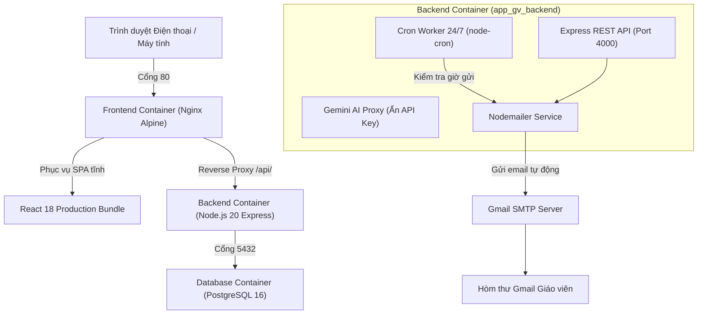

# HƯỚNG DẪN TRIỂN KHAI VÀ VẬN HÀNH DOCKER BACKEND

Tài liệu này hướng dẫn chi tiết cách thức triển khai và vận hành toàn bộ hệ thống bằng **Docker & Docker Compose**, giải quyết triệt để bài toán: **Tự động gửi email lịch dạy mỗi sáng 24/7 ngay cả khi giáo viên tắt điện thoại và máy tính**.

---

## 🐳 1. Kiến trúc Container Tổng thể

Hệ thống được đóng gói thành 3 dịch vụ biệt lập trong tệp `docker-compose.yml`:



### Các dịch vụ trong `docker-compose.yml`:
1. **`postgres` (Database)**: 
   - Sử dụng image chính thức `postgres:16-alpine`.
   - Tự động nạp cấu trúc 11 bảng cơ sở dữ liệu từ `backend/sql/init.sql` ngay lần đầu khởi tạo.
   - Dữ liệu được bảo toàn bền vững trong Docker Volume `postgres_data`.
2. **`backend` (API + Automated Cron)**:
   - Viết bằng Node.js + TypeScript + Express.
   - Tích hợp tiến trình `node-cron` chạy ngầm 24/7: mỗi phút kiểm tra cơ sở dữ liệu, nếu đến giờ đã đặt (`settings.notify_time`, mặc định 06:00 sáng theo giờ Việt Nam `Asia/Ho_Chi_Minh`), tự động truy vấn lịch dạy thực tế trong ngày và gửi email về hòm thư của giáo viên.
   - Cung cấp API đồng bộ dữ liệu hai chiều (`GET/PUT /api/sync` gồm đủ lớp, học sinh, lịch, điểm danh, ghi chú buổi, học phí, cài đặt, nhật ký email) và API Gateway gọi Gemini AI an toàn.
   - Khi container khởi động, backend tự chạy `ensureSchema()` để tạo bảng/chỉ mục nếu volume Postgres chưa có schema hoặc schema cũ thiếu ràng buộc.
3. **`frontend` (Web App + Nginx Reverse Proxy)**:
   - Build ứng dụng React/Vite bằng Docker multi-stage build siêu nhẹ.
   - Chạy máy chủ Nginx lắng nghe ở cổng `80` (hoặc cổng tùy chỉnh trong `.env`).
   - Tự động chuyển tiếp toàn bộ yêu cầu `/api/*` sang container `backend:4000`.

---

## ⚙️ 2. Hướng dẫn Khởi chạy Từng Bước

### Bước 1: Chuẩn bị tệp cấu hình môi trường `.env`
Sao chép tệp `.env.example` thành `.env`:
```powershell
cp .env.example .env
```
Mở tệp `.env` và điền các thông tin:
* `DB_PASSWORD`: Mật khẩu bảo mật cho cơ sở dữ liệu PostgreSQL.
* `GEMINI_API_KEY`: API Key lấy miễn phí tại [Google AI Studio](https://aistudio.google.com/).
* `SMTP_USER`: Địa chỉ Gmail của giáo viên dùng để gửi thư (vd: `giaovien.toan@gmail.com`).
* `SMTP_PASS`: **Mật khẩu ứng dụng (App Password 16 ký tự)** của Gmail. Lấy tại: [Tài khoản Google $\rightarrow$ Bảo mật $\rightarrow$ Mật khẩu ứng dụng](https://myaccount.google.com/apppasswords).

### Bước 2: Khởi động hệ thống bằng Docker Compose
Chạy lệnh duy nhất sau tại thư mục gốc của dự án:
```powershell
docker compose up -d --build
```

Lệnh này sẽ tự động:
1. Tải các base image Node, Nginx và PostgreSQL.
2. Khởi tạo cơ sở dữ liệu và 11 bảng dữ liệu chuẩn.
3. Biên dịch Backend và khởi chạy dịch vụ Cron 24/7.
4. Biên dịch Frontend và khởi chạy Nginx.

### Bước 3: Truy cập ứng dụng
* Mở trình duyệt web trên máy tính hoặc điện thoại: `http://localhost` (hoặc IP máy chủ).
* Kiểm tra API Backend: `http://localhost/api/health` hoặc `http://localhost:4000/api/health` $\rightarrow$ Trả về JSON trạng thái cơ sở dữ liệu và thời gian múi giờ `Asia/Ho_Chi_Minh`.
* Đồng bộ dữ liệu: frontend tự `GET/PUT /api/sync`. Có thể đẩy tay từ **Cài đặt → Đồng bộ PostgreSQL**.

### Chạy riêng Database + Backend (không build frontend)
```powershell
docker compose up -d --build postgres backend
```
Postgres lắng nghe `localhost:5432` (user `postgres`, database `app_gv`, mật khẩu lấy từ `.env`). Backend lắng nghe `localhost:4000`.

---

## ⏰ 3. Cơ chế Hoạt động của Cron Job Gửi Email 24/7

Yêu cầu gốc: *"Mỗi ngày tự gửi lịch dạy của ngày đó qua Gmail cho tôi"*.

Khi chạy bằng Docker:
1. Container `backend` có biến môi trường `TZ=Asia/Ho_Chi_Minh`.
2. Hàm `startCronJobs()` trong `backend/src/cron.ts` kích hoạt tiến trình kiểm tra mỗi phút (`* * * * *`).
3. Tại thời điểm khớp với `notify_time` (ví dụ `06:00` sáng):
   - Truy vấn bảng `holidays`: Nếu hôm nay là ngày nghỉ lễ $\rightarrow$ Tự động bỏ qua không gửi email.
   - Truy vấn các tiết trường hôm nay từ `school_schedule`.
   - Truy vấn các lớp dạy thêm cố định từ `schedule_rules` (đã trừ các buổi bị hủy/dời).
   - Truy vấn các buổi phát sinh và buổi dời đến trong ngày.
   - Soạn thư HTML giao diện đẹp mắt và gửi qua hàm `sendScheduleEmail()`.
   - Ghi lại kết quả thành công hoặc lỗi vào bảng `notification_log`.
4. **Giáo viên không cần mở trình duyệt web hay bật máy tính**, email vẫn gửi đến điện thoại đúng giờ mỗi sáng.

---

## 🛠️ 4. Các Lệnh Quản trị Docker Thường dùng

| Nhu cầu | Lệnh thực hiện |
| :--- | :--- |
| **Xem trạng thái các container** | `docker compose ps` |
| **Xem log trực tiếp của Backend & Cron** | `docker compose logs -f backend` |
| **Xem log của Database** | `docker compose logs -f postgres` |
| **Khởi động lại toàn bộ dịch vụ** | `docker compose restart` |
| **Dừng hệ thống** | `docker compose down` |
| **Sao lưu dữ liệu PostgreSQL ra file SQL** | `docker exec -t app_gv_postgres pg_dump -U postgres app_gv > backup.sql` |
| **Khôi phục dữ liệu từ file SQL** | `docker exec -i app_gv_postgres psql -U postgres app_gv < backup.sql` |

