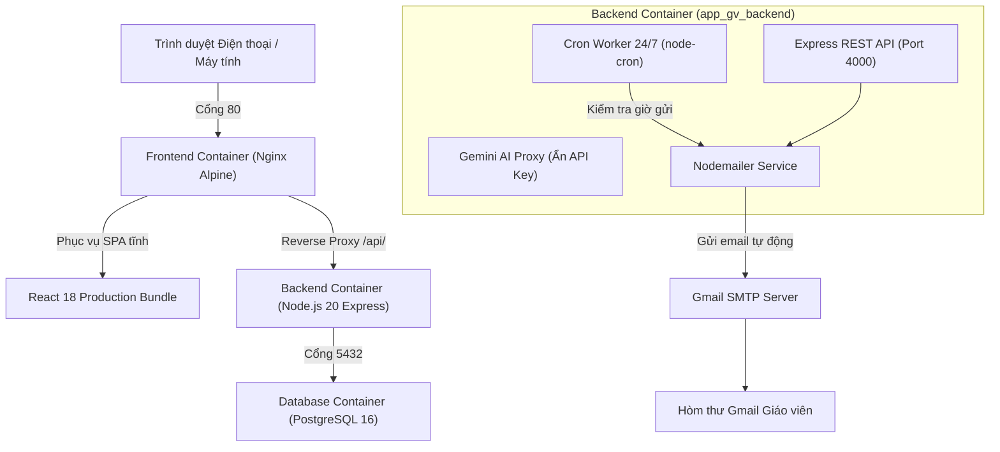

# HƯỚNG DẪN TRIỂN KHAI VÀ VẬN HÀNH DOCKER BACKEND

Tài liệu này hướng dẫn chi tiết cách thức triển khai và vận hành toàn bộ hệ thống bằng **Docker & Docker Compose**, giải quyết triệt để bài toán: **Tự động gửi email lịch dạy mỗi sáng 24/7 ngay cả khi giáo viên tắt điện thoại và máy tính**.

---

## 🐳 1. Kiến trúc Container Tổng thể

Hệ thống được đóng gói thành 3 dịch vụ biệt lập trong tệp `docker-compose.yml`:



### Các dịch vụ trong `docker-compose.yml`:
1. **`postgres` (Database)**: 
   - Sử dụng image chính thức `postgres:16-alpine`.
   - Tự động nạp cấu trúc đầy đủ các bảng cơ sở dữ liệu (bao gồm `profiles`, `app_settings`, `invites`, `audit_log`, `students` với `trial_price`, `student_enrollments`, `student_status_history`, `session_guests`, `school_periods`, `school_schedule`, `school_week_configs`, `payment_transactions`, `month_locks`, `change_log`, `calendar_event_map`, `calendar_sync_log`, `gcal_tokens` và chính sách **Row Level Security - RLS**) từ `backend/sql/init.sql` và `backend/sql/002_supabase_auth_profiles.sql`.
   - Dữ liệu được bảo toàn bền vững trong Docker Volume `postgres_data`.
2. **`backend` (API + Automated Cron + Google Calendar One-Way Sync)**:
   - Viết bằng Node.js + TypeScript + Express.
   - Tích hợp tiến trình `node-cron` chạy ngầm 24/7:
     * Mỗi phút kiểm tra giờ gửi email (`settings.notify_time`, mặc định `06:00` sáng theo giờ Việt Nam `Asia/Ho_Chi_Minh`) để tự động truy vấn lịch dạy thực tế trong ngày và gửi email về hòm thư của giáo viên.
     * Mỗi ngày lúc `01:00` sáng (`0 1 * * *`) tự động chạy tác vụ nền đẩy thêm các tuần mới phía trước lên lịch riêng `"Lịch dạy"` trên Google Calendar (`syncUserGoogleCalendar`).
   - Cung cấp API đồng bộ dữ liệu hai chiều (`GET/PUT /api/sync`), các API đồng bộ một chiều Google Calendar (`/api/gcal/auth-url`, `/api/gcal/callback`, `/api/gcal/connect`, `/api/gcal/sync-now`, `/api/gcal/clear-events`, `/api/gcal/disconnect`, `/api/gcal/feed.ics`) với mã kết nối OAuth mã hóa **AES-256-GCM** lưu phía server (`gcal_tokens`), và API Gateway gọi Gemini AI an toàn.
   - Khi container khởi động, backend tự chạy `ensureSchema()` để tạo bảng/chỉ mục nếu volume Postgres chưa có schema hoặc schema cũ thiếu ràng buộc.
3. **`frontend` (Web App + Nginx Reverse Proxy)**:
   - Build ứng dụng React/Vite bằng Docker multi-stage build siêu nhẹ.
   - Chạy máy chủ Nginx lắng nghe ở cổng `80` (hoặc cổng tùy chỉnh trong `.env`).
   - Tự động chuyển tiếp toàn bộ yêu cầu `/api/*` sang container `backend:4000`.

---

## ⚙️ 2. Hướng dẫn Khởi chạy Từng Bước

### Bước 1: Chuẩn bị tệp cấu hình môi trường `.env`
Sao chép tệp `.env.example` thành `.env`:
```powershell
cp .env.example .env
```
Mở tệp `.env` và điền các thông tin:
* `DB_PASSWORD`: Mật khẩu bảo mật cho cơ sở dữ liệu PostgreSQL.
* `GEMINI_API_KEY`: API Key lấy miễn phí tại [Google AI Studio](https://aistudio.google.com/).
* `SMTP_USER`: Địa chỉ Gmail của giáo viên dùng để gửi thư (vd: `giaovien.toan@gmail.com`).
* `SMTP_PASS`: **Mật khẩu ứng dụng (App Password 16 ký tự)** của Gmail. Lấy tại: [Tài khoản Google $\rightarrow$ Bảo mật $\rightarrow$ Mật khẩu ứng dụng](https://myaccount.google.com/apppasswords).

### Bước 2: Khởi động hệ thống bằng Docker Compose
Chạy lệnh duy nhất sau tại thư mục gốc của dự án:
```powershell
docker compose up -d --build
```

Lệnh này sẽ tự động:
1. Tải các base image Node, Nginx và PostgreSQL.
2. Khởi tạo cơ sở dữ liệu và 11 bảng dữ liệu chuẩn.
3. Biên dịch Backend và khởi chạy dịch vụ Cron 24/7.
4. Biên dịch Frontend và khởi chạy Nginx.

### Bước 3: Truy cập ứng dụng
* Mở trình duyệt web trên máy tính hoặc điện thoại: `http://localhost` (hoặc IP máy chủ).
* Kiểm tra API Backend: `http://localhost/api/health` hoặc `http://localhost:4000/api/health` $\rightarrow$ Trả về JSON trạng thái cơ sở dữ liệu và thời gian múi giờ `Asia/Ho_Chi_Minh`.
* Đồng bộ dữ liệu: frontend tự `GET/PUT /api/sync`. Có thể đẩy tay từ **Cài đặt → Đồng bộ PostgreSQL**.

### Chạy riêng Database + Backend (không build frontend)
```powershell
docker compose up -d --build postgres backend
```
Postgres lắng nghe `localhost:5432` (user `postgres`, database `app_gv`, mật khẩu lấy từ `.env`). Backend lắng nghe `localhost:4000`.

---

## ⏰ 3. Cơ chế Hoạt động của Cron Job Gửi Email 24/7

Yêu cầu gốc: *"Mỗi ngày tự gửi lịch dạy của ngày đó qua Gmail cho tôi"*.

Khi chạy bằng Docker:
1. Container `backend` có biến môi trường `TZ=Asia/Ho_Chi_Minh`.
2. Hàm `startCronJobs()` trong `backend/src/cron.ts` kích hoạt tiến trình kiểm tra mỗi phút (`* * * * *`).
3. Tại thời điểm khớp với `notify_time` (ví dụ `06:00` sáng):
   - Truy vấn bảng `holidays`: Nếu hôm nay là ngày nghỉ lễ $\rightarrow$ Tự động bỏ qua không gửi email.
   - Truy vấn các tiết trường hôm nay từ `school_schedule`.
   - Truy vấn các lớp dạy thêm cố định từ `schedule_rules` (đã trừ các buổi bị hủy/dời).
   - Truy vấn các buổi phát sinh và buổi dời đến trong ngày.
   - Soạn thư HTML giao diện đẹp mắt và gửi qua hàm `sendScheduleEmail()`.
   - Ghi lại kết quả thành công hoặc lỗi vào bảng `notification_log`.
4. **Giáo viên không cần mở trình duyệt web hay bật máy tính**, email vẫn gửi đến điện thoại đúng giờ mỗi sáng.

---

## 🛠️ 4. Các Lệnh Quản trị Docker Thường dùng

| Nhu cầu | Lệnh thực hiện |
| :--- | :--- |
| **Xem trạng thái các container** | `docker compose ps` |
| **Xem log trực tiếp của Backend & Cron** | `docker compose logs -f backend` |
| **Xem log của Database** | `docker compose logs -f postgres` |
| **Khởi động lại toàn bộ dịch vụ** | `docker compose restart` |
| **Dừng hệ thống** | `docker compose down` |
| **Sao lưu dữ liệu PostgreSQL ra file SQL** | `docker exec -t app_gv_postgres pg_dump -U postgres app_gv > backup.sql` |
| **Khôi phục dữ liệu từ file SQL** | `docker exec -i app_gv_postgres psql -U postgres app_gv < backup.sql` |

---

## ⚡ 5. Phương án Deploy 100% Trên Cloudflare (Miễn phí trọn đời - Không bao giờ tắt Server / 0s đợi Wake-up)

Thay vì dùng Render.com bản miễn phí (bị ngủ sau 15 phút không dùng và mất 30–50 giây chờ khởi động lại), toàn bộ dự án (cả **Frontend React** lẫn **Backend API `/api/*`** và **Database**) đã được tích hợp để chạy **100% trên mạng lưới Cloudflare Edge** thông qua **Cloudflare Pages + Pages Functions + Cloudflare D1 Database**:
- **Không bao giờ ngủ (Zero Cold Start - 0ms)**: Vào trang hoặc đăng nhập lúc nào cũng phản hồi ngay lập tức (`< 20ms`).
- **Chung một tên miền duy nhất (`https://<ten-du-an>.pages.dev`)**: Cả giao diện web và API `/api/*` nằm chung trên Cloudflare Pages nên không cần cấu hình CORS hay URL backend rời.
- **100% Miễn phí**: Băng thông web không giới hạn, 100.000 lượt gọi API/ngày, 5GB lưu trữ SQL trên Cloudflare D1 (5.000.000 lượt đọc/ngày).

### Các tệp đã được cấu hình sẵn trong dự án:
- [`frontend/functions/api/[[route]].ts`](file:///d:/app_gv/frontend/functions/api/[[route]].ts) & [`functions/api/[[route]].ts`](file:///d:/app_gv/functions/api/[[route]].ts): Toàn bộ Backend API (`/api/auth/*`, `/api/profile/*`, `/api/admin/*`, `/api/sync`, `/api/email/test`, `/api/ai/*`) chạy trực tiếp trên Cloudflare Pages Functions.
- [`cloudflare/d1-schema.sql`](file:///d:/app_gv/cloudflare/d1-schema.sql): Cấu trúc bảng `kv_store` cho Cloudflare D1 (hệ thống cũng tự động chạy lệnh `CREATE TABLE IF NOT EXISTS` ngay lần truy cập đầu tiên nên không cần chạy SQL thủ công).
- [`frontend/wrangler.toml`](file:///d:/app_gv/frontend/wrangler.toml) & [`wrangler.toml`](file:///d:/app_gv/wrangler.toml): Cấu hình chuẩn cho Cloudflare Pages.

### Hướng dẫn từng bước Deploy lên Cloudflare (Chỉ mất ~5 phút):

#### Bước 1: Đẩy code lên GitHub cá nhân
```bash
git add .
git commit -m "Deploy fullstack len Cloudflare Pages + D1"
git push origin main
```

#### Bước 2: Tạo Database miễn phí trên Cloudflare D1
1. Đăng nhập vào [Cloudflare Dashboard](https://dash.cloudflare.com/).
2. Ở menu bên trái, chọn **Storage & Databases** $\rightarrow$ **D1 SQL Database**.
3. Bấm nút **Create Database**, đặt tên là `lich-day-db` rồi bấm **Create**.
   *(Không cần chạy lệnh tạo bảng thủ công vì code trong `functions/api/[[route]].ts` sẽ tự động khởi tạo bảng `kv_store` và nạp sẵn tài khoản Admin + Giáo viên ngay lần mở đầu tiên!)*

#### Bước 3: Tạo dự án trên Cloudflare Pages (Gồm cả Frontend + Backend API)
1. Ở menu bên trái Cloudflare, vào **Compute (Workers)** $\rightarrow$ **Workers & Pages**.
2. Bấm nút **Create** $\rightarrow$ chọn tab **Pages** $\rightarrow$ bấm **Import an existing Git repository** (hoặc **Connect to Git**).
3. Chọn tài khoản GitHub và chọn kho lưu trữ (repository) dự án của bạn $\rightarrow$ bấm **Begin setup**.
4. Tại màn hình **Set up builds and deployments**, điền như sau:
   - **Project name**: `app-lich-day-gv` (hoặc tên bạn thích)
   - **Production branch**: `main`
   - **Framework preset**: Chọn `Vite`
   - **Root directory (advanced)**: Nhập `frontend`
   - **Build command**: `npm run build`
   - **Build output directory**: `dist`
5. Bấm **Save and Deploy** và đợi khoảng 1 phút để Cloudflare xuất bản trang web lần đầu.

#### Bước 4: Gắn Database D1 (`DB`) vào dự án Cloudflare Pages
1. Sau khi deploy xong, trong trang quản lý dự án `app-lich-day-gv` trên Cloudflare Pages, chuyển sang tab **Settings**.
2. Kéo xuống mục **Bindings** (hoặc **Functions** $\rightarrow$ **D1 database bindings**) $\rightarrow$ bấm **Add** $\rightarrow$ chọn **D1 database**:
   - **Variable name**: Nhập chính xác là `DB` *(viết hoa)*
   - **D1 database**: Chọn `lich-day-db` (đã tạo ở Bước 2)
   - Bấm **Save**.
3. Chuyển sang tab **Deployments**, bấm vào biểu tượng `...` ở bản deploy mới nhất và chọn **Retry deployment** để kích hoạt kết nối Database D1.

#### Bước 5: Đăng nhập và sử dụng ngay (Không bao giờ phải đợi!)
Truy cập địa chỉ `https://app-lich-day-gv.pages.dev` của bạn:
- **Tài khoản Giáo viên (đã nạp sẵn đủ 14 lớp dạy thêm & lịch dạy trường của bạn)**:
  - Email: `giaovien@lichday.vn`
  - Mật khẩu: `Giaovien123`
- **Tài khoản Quản trị viên (Admin)**:
  - Email: `admin@lichday.vn`
  - Mật khẩu: `Admin123456`


