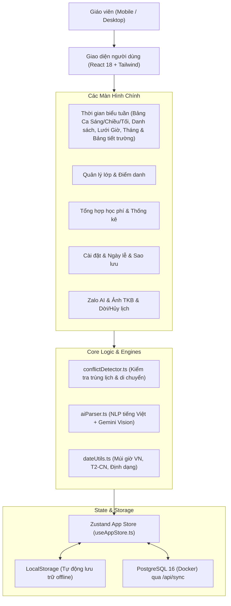

# KIẾN TRÚC HỆ THỐNG VÀ MÔ HÌNH DỮ LIỆU

Tài liệu này giải thích chi tiết thiết kế kỹ thuật, mô hình cơ sở dữ liệu và các thuật toán lõi của hệ thống quản lý lịch dạy.

---

## 🏗️ 1. Kiến trúc Hệ thống Tổng thể

Ứng dụng được xây dựng theo mô hình **Component-Driven Single Page Application (SPA)** với phân tách trách nhiệm rõ ràng:

---

## 🗄️ 2. Mô hình Cơ sở Dữ liệu (Database Schema)

Dưới đây là đặc tả chi tiết các bảng dữ liệu, tương thích hoàn toàn với PostgreSQL 16 / Supabase:

### 2.0. Nhóm Bảng Tài khoản, Hồ sơ & Bảo mật (`profiles`, `app_settings`, `invites`, `audit_log`)
- **`profiles`**: (`id` PK, `full_name`, `email` UNIQUE, `phone`, `school`, `avatar_url`, `role` `'admin' | 'teacher'`, `status` `'pending' | 'active' | 'locked'`, `email_verified`, `auth_provider`, `created_at`, `approved_by`, `approved_at`, `last_login_at`, `locked_reason`). Cột `role` chỉ nhận `'admin'` khi email đã xác minh trùng khớp với biến môi trường `ADMIN_EMAIL` ở phía server.
- **`app_settings`**: (`id = 'global'`, `registration_mode = 'pending_approval' | 'open' | 'invite_only'`, `google_login_enabled`, `password_login_enabled`, `notify_admin_email`, `max_accounts`).
- **`invites`**: (`id`, `email`, `code`, `max_uses`, `used_count`, `expires_at`, `created_by`, `created_at`, `revoked`).
- **`audit_log`**: (`id`, `actor_id`, `target_id`, `action`, `detail` JSONB, `ip_masked`, `created_at`).
- **Phân tách Không gian Nghiệp vụ Admin & Hồ sơ Cá nhân**:
  * `AdminDashboardPage.tsx` (`/admin`): Dành riêng cho tài khoản `role === 'admin'` (kiểm tra nghiêm ngặt qua `ADMIN_EMAIL` trên server), cung cấp 4 phân hệ quản trị (`accounts`, `invites`, `settings`, `audit`) và tách biệt hoàn toàn khỏi dữ liệu lớp học/học sinh của giáo viên.
  * `ProfilePage.tsx` (`/profile`): Phục vụ cả Admin và Giáo viên để quản lý định danh, đổi mật khẩu, thu hồi phiên đăng nhập từ xa (`token_version`) và sao lưu dữ liệu.

### 2.1. Bảng `classes` (Lớp dạy thêm)
| Cột | Kiểu dữ liệu | Ràng buộc | Mô tả |
| :--- | :--- | :--- | :--- |
| `id` | `TEXT` | `PRIMARY KEY` | Mã định danh duy nhất của lớp. |
| `name` | `TEXT` | `NOT NULL` | Tên lớp (vd: "Toán 9 Nâng cao"). |
| `location` | `TEXT` | `DEFAULT ''` | Địa điểm dạy (vd: "Nhà riêng", "Trung tâm ABC"). |
| `price` | `INTEGER` | `NOT NULL, >= 0` | Đơn giá chung cho một buổi học (VNĐ). |
| `color` | `TEXT` | `NOT NULL` | Mã màu HEX để nhận diện trên lịch. |
| `created_at` | `TIMESTAMPTZ`| `DEFAULT now()` | Thời điểm tạo lớp. |
| `user_id` | `TEXT` | `NOT NULL` | ID giáo viên sở hữu. |

---

### 2.2. Bảng `students` (Học sinh)
| Cột | Kiểu dữ liệu | Ràng buộc | Mô tả |
| :--- | :--- | :--- | :--- |
| `id` | `TEXT` | `PRIMARY KEY` | Mã định danh học sinh. |
| `class_id` | `TEXT` | `REFERENCES classes(id)` | Lớp học mà học sinh đang theo học. |
| `name` | `TEXT` | `NOT NULL` | Họ và tên học sinh. |
| `parent_name` | `TEXT` | `NULLABLE` | Tên phụ huynh đại diện. |
| `parent_phone`| `TEXT` | `NULLABLE` | Số điện thoại liên hệ phụ huynh. |
| `custom_price`| `INTEGER` | `NULLABLE` | Giá học phí riêng (nếu để trống thì lấy theo giá lớp). |
| `trial_price` | `INTEGER` | `NULLABLE` | Giá học phí học thử/buổi (mặc định `NULL` = bằng học phí đi học chính thức; có thể chỉnh thành `0` hoặc mức riêng). |
| `status` | `TEXT` | `active / trial / left` | Trạng thái: Đang học, Học thử, Đã nghỉ. |
| `note` | `TEXT` | `NULLABLE` | Ghi chú học lực hoặc nhắc nhở. |
| `created_at` | `TIMESTAMPTZ`| `DEFAULT now()` | Ngày gia nhập lớp. |

---

### 2.3. Bảng `schedule_rules` (Quy tắc lặp lịch dạy thêm hằng tuần)
| Cột | Kiểu dữ liệu | Ràng buộc | Mô tả |
| :--- | :--- | :--- | :--- |
| `id` | `TEXT` | `PRIMARY KEY` | Mã quy tắc. |
| `class_id` | `TEXT` | `REFERENCES classes(id)` | Khóa ngoại trỏ đến lớp học. |
| `weekday` | `INTEGER` | `1..7` | Thứ trong tuần: `1 = Thứ 2 ... 7 = Chủ nhật`. |
| `start_time` | `TEXT` | `HH:mm` | Giờ bắt đầu (vd: `18:00`). |
| `end_time` | `TEXT` | `HH:mm` | Giờ kết thúc (vd: `19:30`). |
| `valid_from` | `DATE` | `NOT NULL` | Ngày bắt đầu có hiệu lực (`YYYY-MM-DD`). |
| `valid_to` | `DATE` | `NULLABLE` | Ngày kết thúc hiệu lực (nếu không giới hạn thì `NULL`). |
| `user_id` | `TEXT` | `NOT NULL` | ID giáo viên. |

---

### 2.4. Bảng `session_exceptions` (Ngoại lệ lịch - Dời hoặc Hủy buổi)
| Cột | Kiểu dữ liệu | Ràng buộc | Mô tả |
| :--- | :--- | :--- | :--- |
| `id` | `TEXT` | `PRIMARY KEY` | Mã ngoại lệ. |
| `rule_id` | `TEXT` | `REFERENCES schedule_rules(id)` | Thuộc về quy tắc lặp nào. |
| `original_date`| `DATE` | `NOT NULL` | Ngày của buổi học gốc bị tác động. |
| `action` | `TEXT` | `moved / cancelled` | Hành động: `moved` (dời lịch) hoặc `cancelled` (hủy buổi). |
| `new_date` | `DATE` | `NULLABLE` | Ngày mới (nếu action = moved). |
| `new_start` | `TEXT` | `NULLABLE` | Giờ bắt đầu mới (HH:mm). |
| `new_end` | `TEXT` | `NULLABLE` | Giờ kết thúc mới (HH:mm). |
| `reason` | `TEXT` | `NULLABLE` | Lý do dời hoặc hủy. |
| `needs_makeup` | `BOOLEAN` | `DEFAULT false` | Có đánh dấu cần dạy bù hay không. |

---

### 2.5. Bảng `extra_sessions` (Buổi học phát sinh / Buổi dạy bù)
| Cột | Kiểu dữ liệu | Ràng buộc | Mô tả |
| :--- | :--- | :--- | :--- |
| `id` | `TEXT` | `PRIMARY KEY` | Mã buổi phát sinh. |
| `class_id` | `TEXT` | `REFERENCES classes(id)` | Thuộc về lớp học nào. |
| `date` | `DATE` | `NOT NULL` | Ngày diễn ra buổi phát sinh (`YYYY-MM-DD`). |
| `start_time` | `TEXT` | `HH:mm` | Giờ bắt đầu. |
| `end_time` | `TEXT` | `HH:mm` | Giờ kết thúc. |
| `note` | `TEXT` | `NULLABLE` | Ghi chú lý do phát sinh. |
| `makeup_for` | `TEXT` | `NULLABLE` | ID ngoại lệ gốc nếu đây là buổi dạy bù. |
| `custom_price` | `INTEGER` | `NULLABLE` | Học phí riêng của buổi phát sinh (nếu để trống `NULL` thì dùng giá mặc định của lớp). |

---

### 2.6. Bảng `school_periods` (Bảng giờ các tiết của trường) và `school_schedule` (Thời khóa biểu trường theo tiết)

#### 2.6.1. Bảng `school_periods` (Cấu hình giờ từng tiết S1–S5, C1–C5)
| Cột | Kiểu dữ liệu | Ràng buộc | Mô tả |
| :--- | :--- | :--- | :--- |
| `id` | `TEXT` | `PRIMARY KEY` | Mã định danh tiết cấu hình. |
| `period_code` | `TEXT` | `NOT NULL` | Mã tiết chuẩn: `S1..S5` (Sáng tiết 1–5) hoặc `C1..C5` (Chiều tiết 1–5). |
| `session` | `TEXT` | `'morning' / 'afternoon'` | Buổi sáng hoặc buổi chiều. |
| `start_time` | `TEXT` | `HH:mm` | Giờ bắt đầu tiết (vd: `07:00`). |
| `end_time` | `TEXT` | `HH:mm` | Giờ kết thúc tiết (vd: `07:45`). |
| `schedule_name`| `TEXT` | `DEFAULT 'Giờ chuẩn'` | Tên bộ giờ (vd: `Giờ chuẩn`, `Giờ Mùa Hè`, `Giờ Mùa Đông`). |
| `valid_from` | `DATE` | `NOT NULL` | Ngày bắt đầu áp dụng bộ giờ. |
| `valid_to` | `DATE` | `NULLABLE` | Ngày kết thúc áp dụng bộ giờ. |
| `user_id` | `TEXT` | `NOT NULL` | ID giáo viên. |

#### 2.6.2. Bảng `school_schedule` (Thời khóa biểu trường theo từng tiết & từng tuần) và `school_week_configs`
| Cột | Kiểu dữ liệu | Ràng buộc | Mô tả |
| :--- | :--- | :--- | :--- |
| `id` | `TEXT` | `PRIMARY KEY` | Mã tiết học trường. |
| `week_start` | `DATE` | `NOT NULL` | Ngày Thứ 2 (`YYYY-MM-DD`) của tuần áp dụng thời khóa biểu trường này (Nhóm B3). |
| `weekday` | `INTEGER` | `1..7` | Thứ trong tuần (`1 = Thứ 2 ... 7 = Chủ nhật`). |
| `period_code` | `TEXT` | `NOT NULL` | Mã tiết liên kết với `school_periods` (`S1..S5`, `C1..C5`). |
| `session` | `TEXT` | `'morning' / 'afternoon'` | Buổi sáng hoặc buổi chiều. |
| `cell_type` | `TEXT` | `'class' / 'duty' / 'other'` | Loại ô: `class` (dạy lớp), `duty` (trực chiều `13:30–16:30` hoặc trực tiết sáng), `other` (sinh hoạt/họp). |
| `class_name` | `TEXT` | `NOT NULL` | Tên lớp trường (vd: `10A1`) hoặc `"Trực"` nếu `cell_type = 'duty'`. |
| `subject` | `TEXT` | `NOT NULL` | Môn giảng dạy (vd: `Toán`) hoặc nội dung trực. |
| `room` | `TEXT` | `DEFAULT ''` | Số phòng học (vd: `P.201`). |
| `note` | `TEXT` | `DEFAULT ''` | Ghi chú thêm cho tiết dạy hoặc tiết trực. |
| `valid_from` | `DATE` | `NOT NULL` | Ngày bắt đầu tuần áp dụng. |
| `valid_to` | `DATE` | `NULLABLE` | Ngày kết thúc tuần áp dụng. |

- **Bảng `school_week_configs`** (`id`, `week_start`, `afternoon_long_break`, `afternoon_long_break_minutes`, `teacher_name`, `declared_period_count`, `user_id`): Lưu cấu hình riêng của từng tuần (tuần đó buổi chiều có ra chơi dài 20 phút sau tiết C2 hay không, tên giáo viên và tổng số tiết khai báo trên ảnh TKB).
- **Bảng `student_enrollments`** (`id`, `student_id`, `class_id`, `role = 'primary' | 'extra'`, `schedule_rule_ids` JSONB, `price_override`, `from_date`, `to_date`, `note`, `user_id`): Quản lý quá trình ghi danh dài hạn của học sinh ở lớp chính, chuyển lớp giữa tháng và đăng ký học thêm dài hạn ở lớp thứ 2 (Nhóm D & E).
- **Bảng `student_status_history`** (`id`, `student_id`, `enrollment_id`, `status = 'trial' | 'active' | 'left'`, `effective_from`, `note`, `created_at`, `user_id`): Lưu lịch sử chuyển trạng thái học thử $\rightarrow$ đang học $\rightarrow$ đã nghỉ theo ngày hiệu lực (Nhóm A).
- **Bảng `session_guests`** (`id`, `student_id`, `host_class_id`, `date`, `start_time`, `kind = 'swap' | 'extra'`, `home_class_id`, `home_session_key`, `billing_mode = 'free' | 'home_price' | 'host_price' | 'custom'`, `custom_amount`, `billed_class_id`, `reason`, `user_id`): Lưu các buổi học ghép / học bù ngắn hạn sang lớp khác (Nhóm D).

> [!TIP]
> **Cơ chế Quy đổi Giờ tự động & Chuyển đổi Dữ liệu Cũ (`schoolPeriods.ts`)**:
> - Lịch trường lưu theo `period_code` (`S1`, `C2`...), khi vẽ lên lưới lịch hoặc kiểm tra trùng giờ sẽ tự động tra cứu `start_time` và `end_time` từ bảng `school_periods`. Khi trường đổi giờ mùa hè/mùa đông, toàn bộ lịch trường tự động cập nhật mà không cần nhập lại.
> - Các tiết liền nhau của cùng một lớp trong cùng một buổi (ví dụ `S1` và `S2` cùng dạy `10A1`) tự động gộp thành một khối `S1–S2 · 10A1`.
> - Dữ liệu lịch trường kiểu cũ (lưu chuỗi `"Tiết 1-2"`) được hàm `migrateLegacySchoolSchedule` tự động sao lưu vào `localStorage['gv-app-backup-before-v2-migration']` trước khi tách sang từng mã tiết `S1`, `S2`.

---

### 2.7. Bảng `attendance` (Điểm danh buổi học)
| Cột | Kiểu dữ liệu | Ràng buộc | Mô tả |
| :--- | :--- | :--- | :--- |
| `id` | `TEXT` | `PRIMARY KEY` | Mã lượt điểm danh. |
| `class_id` | `TEXT` | `REFERENCES classes(id)` | Mã lớp. |
| `date` | `DATE` | `NOT NULL` | Ngày diễn ra buổi học thực tế. |
| `start_time` | `TEXT` | `HH:mm` | Giờ bắt đầu của buổi học thực tế. |
| `student_id` | `TEXT` | `REFERENCES students(id)` | Mã học sinh. |
| `status` | `TEXT` | `present / absent / excused` | Trạng thái: Có mặt, Vắng không phép, Vắng có phép. |

> [!IMPORTANT]
> **Điểm danh gắn với Buổi học thực tế (`class_id + date + start_time`)**, KHÔNG gắn với quy tắc cố định (`rule_id`). Nhờ đó, các buổi dời sang ngày khác, buổi dạy bù hay buổi phát sinh đều được điểm danh chính xác tại thời điểm học thực tế.

---

### 2.8. Các bảng Quản lý Công nợ Học phí & Đồng bộ Google Calendar (Mục 2.9, 2.10, Mục 3)
- **`payment_transactions`** (`id`, `student_id`, `amount`, `paid_at`, `method`, `note`, `group_id` nullable, `created_at`, `user_id`) — Thay thế bảng `payments` cũ. Mọi khoản tiền phụ huynh đóng được ghi thành một giao dịch thu riêng; hỗ trợ chia 1 khoản thu cho nhiều học sinh anh chị em cùng phụ huynh qua `group_id`.
- **`month_locks`** (`id`, `class_id`, `month`, `locked_at`, `snapshot` JSONB, `user_id`) — Lưu số tiền phải thu đã chốt (`Chốt tháng`) theo lớp; các thay đổi điểm danh hoặc giá về sau không làm đổi số đã chốt trừ khi mở chốt.
- **`change_log`** (`id`, `entity`, `entity_id`, `action`, `before` JSONB, `after` JSONB, `created_at`, `user_id`) — Nhật ký sửa/xóa khoản thu và khóa/mở chốt tháng.
- **`calendar_event_map`** (`id`, `session_key`, `google_event_id`, `content_hash`, `last_synced_at`, `user_id`) — Ánh xạ từng buổi dạy thực tế sang sự kiện trên lịch riêng `"Lịch dạy"` của Google Calendar để đồng bộ một chiều bất biến (idempotent).
- **`calendar_sync_log`** (`id`, `synced_at`, `created`, `updated`, `deleted`, `status`, `error`, `user_id`) — Lịch sử các lượt đồng bộ Google Calendar.
- **`gcal_tokens`** (`user_id` PK, `encrypted_tokens`, `calendar_id`, `account_email`, `mode`, `token_expired`, `updated_at`) — Bảng chỉ dùng phía máy chủ, lưu mã kết nối OAuth (`refresh_token` / `access_token`) đã mã hóa **AES-256-GCM**, không bao giờ gửi xuống trình duyệt.
- **`holidays`**: `id`, `date`, `note`, `user_id` — Unique `(user_id, date)`. Ngày nghỉ lễ/nghỉ chung (tự động ẩn các buổi học).
- **`session_notes`**: `id`, `class_id`, `date`, `start_time`, `content`, `user_id` — Nội dung bài giảng và bài tập về nhà theo từng buổi.
- **`settings`**: Thêm các trường `gcal_enabled`, `gcal_calendar_id`, `gcal_connected`, `gcal_account_email`, `gcal_token_expired`, `gcal_content` (`'school' | 'extra' | 'both'`), `gcal_reminders`, `gcal_school_reminders`, `gcal_extra_reminders`, `gcal_weeks_ahead`, `gcal_travel_reminder`.
- **`notification_log`**: `id`, `sent_at`, `to_email`, `status`, `error`, `subject`, `user_id` — Nhật ký các email thông báo đã gửi.
- **Row Level Security (RLS)**: Tất cả bảng mới đều bật `ENABLE ROW LEVEL SECURITY` kèm policy kiểm tra `user_id` để mỗi tài khoản chỉ đọc/ghi dữ liệu của chính mình.

### 2.9. API đồng bộ, Hồ sơ & Google Calendar
- `GET /api/sync?user_id=local` — kéo toàn bộ snapshot (bao gồm `paymentTransactions`, `monthLocks`, `changeLogs`, `calendarEventMap`, `calendarSyncLogs`).
- `PUT /api/sync` (hoặc `POST`) — cập nhật snapshot trong một transaction và tự động kích hoạt đồng bộ Google Calendar chạy ngầm (debounce 3.5 giây).
- `POST /api/profile/onboarding-complete` (và `PUT /api/profile/me` với `onboarding_completed: true`) — lưu trạng thái đã xem hướng dẫn sử dụng (`onboarding_completed`) theo tài khoản người dùng trên server/database.
- `GET /api/gcal/auth-url`, `GET /api/gcal/callback`, `POST /api/gcal/connect`, `POST /api/gcal/sync-now`, `POST /api/gcal/clear-events`, `POST /api/gcal/disconnect`, `GET /api/gcal/feed.ics`.
- `GET /api/health` — kiểm tra Postgres.
- `POST /api/email/test`, `POST /api/ai/parse-zalo`, `POST /api/ai/parse-school-image`.

---

## 🧮 3. Công thức và Thuật toán Lõi

### 3.1. Thuật toán tính Lịch hiển thị thực tế (Virtual Calendar Resolution)
Đối với mỗi ngày $d$ trong tuần được chọn:
1. **Kiểm tra nghỉ lễ**: Nếu ngày $d \in \text{holidays}$, hiển thị khối thông báo nghỉ lễ, bỏ qua toàn bộ lịch dạy.
2. **Lấy tiết trường**: Lấy tất cả tiết trong `school_schedule` có `weekday` trùng với thứ của ngày $d$ và $d$ nằm trong khoảng `[valid_from, valid_to]`.
3. **Lấy lịch dạy thêm cố định**: Duyệt các quy tắc trong `schedule_rules`:
   * Nếu có ngoại lệ `action == 'cancelled'` cho ngày $d$: Đổi thành khối mờ gạch ngang với cờ `is_cancelled = true`.
   * Nếu có ngoại lệ `action == 'moved'` dời đi từ ngày $d$: Hiển thị mờ gạch ngang kèm mũi tên `➔ Dời sang [new_date] [new_start]`.
   * Nếu không có ngoại lệ: Giữ nguyên lịch cố định bình thường.
4. **Cộng các buổi dời đến**: Duyệt các ngoại lệ `action == 'moved'` có `new_date == d`. Thêm vào ngày $d$ dưới dạng buổi dời đến.
5. **Cộng các buổi phát sinh**: Duyệt `extra_sessions` có `date == d`. Thêm vào ngày $d$ với nhãn tím `Phát sinh`.
6. **Sắp xếp**: Sắp xếp toàn bộ các buổi học theo giờ bắt đầu (`start_time`) tăng dần.

---

### 3.2. Thuật toán Kiểm tra Xung đột Lịch (`checkScheduleConflict`)
Hàm tập trung nhận vào `{ date, start_time, end_time, class_id, location, exclude_id }` và thực hiện 2 cấp độ kiểm tra:

1. **Kiểm tra Trùng lặp Thời gian (Overlap Check)**:
   Hai khoảng thời gian $[s_1, e_1]$ và $[s_2, e_2]$ được coi là trùng nhau nếu:
   $$s_1 < e_2 \quad \text{và} \quad s_2 < e_1$$
   * Kiểm tra với mọi tiết trường trong ngày.
   * Kiểm tra với mọi buổi dạy thêm cố định chưa bị hủy/dời.
   * Kiểm tra với mọi buổi đã dời đến và mọi buổi phát sinh trong ngày đó.
   * *Nếu phát hiện trùng*: Đặt `severity = 'error'` và trả về thông báo đỏ chi tiết buổi học bị xung đột.

2. **Kiểm tra Thời gian Di chuyển (Travel Buffer Check)**:
   Nếu buổi học dự kiến và một buổi học khác trong ngày không trùng nhau nhưng:
   $$\min(|s_1 - e_2|, |s_2 - e_1|) < 20 \text{ phút}$$
   đồng thời hai buổi diễn ra ở hai địa điểm khác nhau (`location_1 != location_2`), hệ thống đặt `severity = 'warning'` để nhắc nhở giáo viên lưu ý thời gian di chuyển giữa hai nơi.

---

### 3.3. Quy tắc Tính Học phí Minh bạch & Phân bổ Công nợ FIFO (`debtEngine.ts`)
Đối với học sinh $s$ thuộc lớp $c$ trong tháng $M$:
- Gọi $P$ là tập các buổi học sinh $s$ có trạng thái điểm danh là `present` trong tháng $M$.
- Gọi $price$ là đơn giá áp dụng (tính bằng số nguyên VNĐ):
  $$price = \begin{cases} 0 & \text{nếu } s.status == \text{'trial'} \\ s.custom\_price & \text{nếu } s.custom\_price \neq \text{null} \\ c.price & \text{ngược lại} \end{cases}$$
- **Phải thu của tháng $M$**:
  $$\text{Phải thu}(M) = |P| \times price$$
  *(Nếu tháng $M$ của lớp $c$ đã được **Chốt tháng (`month_locks`)**, hệ thống lấy trực tiếp `due_amount` từ `snapshot` đã chốt).*
- **Số dư tích lũy cuối tháng $M$**:
  $$\text{Số dư}(M) = \sum_{t \le M} \text{Đã thu}(t) - \sum_{k \le M} \text{Phải thu}(k)$$
  * Số dư âm (`< 0`): Học sinh **đang nợ**.
  * Số dư dương (`> 0`): Học sinh **đã đóng trước / đóng dư**, tự động trừ vào các tháng sau.
- **Phân bổ FIFO**: Toàn bộ các giao dịch trong `payment_transactions` của học sinh được cộng thành quỹ tiền thu và phân bổ lần lượt vào khoản nợ của tháng cũ nhất trước. Mỗi tháng nhận một trong 4 trạng thái: `"Đủ"`, `"Còn thiếu"`, `"Chưa đóng"`, hoặc `"Đóng dư"`.

---

### 3.4. Cơ chế Phân tích Tin nhắn Zalo (Hybrid AI & Vietnamese NLP)
1. **Chế độ Ngoại tuyến (Rule-based NLP Engine)**:
   - Sử dụng Regex và từ điển tiếng Việt tự nhiên để nhận diện:
     * Hành động: `dời`, `chuyển`, `đổi`, `hoãn` $\rightarrow$ `move`; `nghỉ`, `hủy`, `bận`, `ko học` $\rightarrow$ `cancel`; `học`, `dạy`, `thêm` $\rightarrow$ `add`.
     * Ngày tương đối: `hôm nay`, `tối nay`, `mai`, `mốt`, `tuần sau`.
     * Thứ: `T2` đến `T7`, `CN`, `thứ hai` ... `chủ nhật`.
     * Khung giờ: `9h-11h`, `19h30`, `7h tối`, `sáng`, `chiều`.
     * Khớp tên lớp: Fuzzy matching với danh sách lớp hiện có của giáo viên.
2. **Chế độ Đám mây (Google Gemini 1.5 API)**:
   - Khi có API Key, gửi Prompt chuyên sâu ép trả về định dạng JSON có cấu trúc chính xác (Structured Output).
   - Nếu là ảnh chụp TKB trường, sử dụng mô hình Gemini 1.5 Flash Vision đọc dạng lưới để bóc tách toàn bộ tiết học thành bảng.

---

### 3.5. Cơ chế Đồng bộ Lịch Một chiều sang Google Calendar (`gcal.ts`)
1. **Nguồn duy nhất (Single Source of Truth)**: Ứng dụng giải quyết lịch thực tế trong `N` tuần phía trước (`gcal_weeks_ahead`, mặc định 8 tuần) theo múi giờ `Asia/Ho_Chi_Minh`.
2. **Đối chiếu Bất biến (Idempotent Diffing)**:
   - Mỗi buổi dạy thực tế có khóa định danh `session_key` và mã băm nội dung SHA-256 `content_hash`.
   - Đối chiếu với bảng `calendar_event_map`:
     * Chưa có `session_key` $\rightarrow$ Tạo sự kiện mới trên lịch `"Lịch dạy"` (`POST /calendars/{id}/events`).
     * Đã có `session_key` nhưng `content_hash` thay đổi (đổi giờ, dời lịch, sửa ghi chú, đổi phút nhắc) $\rightarrow$ Cập nhật sự kiện (`PUT`).
     * `session_key` trong `calendar_event_map` không còn trong lịch thực tế (do hủy buổi hoặc thêm ngày nghỉ lễ) $\rightarrow$ Xóa sự kiện (`DELETE`).
     * `content_hash` trùng khớp $\rightarrow$ Bỏ qua (không tốn lượt gọi API).
3. **Chống giới hạn tần suất & Cô lập lỗi**: Tự động thử lại theo cấp số nhân (`retryWithBackoff`) khi gặp HTTP `429/5xx`; nếu một sự kiện lỗi sẽ ghi nhận vào `calendar_sync_log` (`status = 'partial'`) và tiếp tục đồng bộ các sự kiện còn lại.

