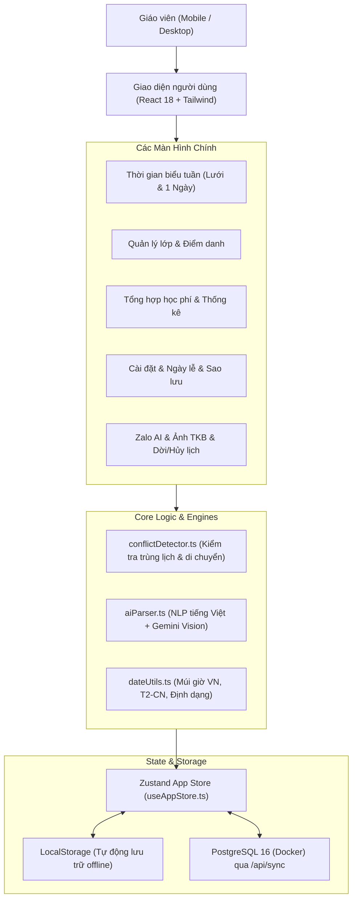

# KIẾN TRÚC HỆ THỐNG VÀ MÔ HÌNH DỮ LIỆU

Tài liệu này giải thích chi tiết thiết kế kỹ thuật, mô hình cơ sở dữ liệu và các thuật toán lõi của hệ thống quản lý lịch dạy.

---

## 🏗️ 1. Kiến trúc Hệ thống Tổng thể

Ứng dụng được xây dựng theo mô hình **Component-Driven Single Page Application (SPA)** với phân tách trách nhiệm rõ ràng:

---

## 🗄️ 2. Mô hình Cơ sở Dữ liệu (Database Schema)

Dưới đây là đặc tả chi tiết 11 bảng dữ liệu, tương thích hoàn toàn với PostgreSQL / Supabase:

### 2.1. Bảng `classes` (Lớp dạy thêm)
| Cột | Kiểu dữ liệu | Ràng buộc | Mô tả |
| :--- | :--- | :--- | :--- |
| `id` | `TEXT` | `PRIMARY KEY` | Mã định danh duy nhất của lớp. |
| `name` | `TEXT` | `NOT NULL` | Tên lớp (vd: "Toán 9 Nâng cao"). |
| `location` | `TEXT` | `DEFAULT ''` | Địa điểm dạy (vd: "Nhà riêng", "Trung tâm ABC"). |
| `price` | `INTEGER` | `NOT NULL, >= 0` | Đơn giá chung cho một buổi học (VNĐ). |
| `color` | `TEXT` | `NOT NULL` | Mã màu HEX để nhận diện trên lịch. |
| `created_at` | `TIMESTAMPTZ`| `DEFAULT now()` | Thời điểm tạo lớp. |
| `user_id` | `TEXT` | `NOT NULL` | ID giáo viên sở hữu. |

---

### 2.2. Bảng `students` (Học sinh)
| Cột | Kiểu dữ liệu | Ràng buộc | Mô tả |
| :--- | :--- | :--- | :--- |
| `id` | `TEXT` | `PRIMARY KEY` | Mã định danh học sinh. |
| `class_id` | `TEXT` | `REFERENCES classes(id)` | Lớp học mà học sinh đang theo học. |
| `name` | `TEXT` | `NOT NULL` | Họ và tên học sinh. |
| `parent_name` | `TEXT` | `NULLABLE` | Tên phụ huynh đại diện. |
| `parent_phone`| `TEXT` | `NULLABLE` | Số điện thoại liên hệ phụ huynh. |
| `custom_price`| `INTEGER` | `NULLABLE` | Giá học phí riêng (nếu để trống thì lấy theo giá lớp). |
| `status` | `TEXT` | `active / trial / left` | Trạng thái: Đang học, Học thử (0đ), Đã nghỉ. |
| `note` | `TEXT` | `NULLABLE` | Ghi chú học lực hoặc nhắc nhở. |
| `created_at` | `TIMESTAMPTZ`| `DEFAULT now()` | Ngày gia nhập lớp. |

---

### 2.3. Bảng `schedule_rules` (Quy tắc lặp lịch dạy thêm hằng tuần)
| Cột | Kiểu dữ liệu | Ràng buộc | Mô tả |
| :--- | :--- | :--- | :--- |
| `id` | `TEXT` | `PRIMARY KEY` | Mã quy tắc. |
| `class_id` | `TEXT` | `REFERENCES classes(id)` | Khóa ngoại trỏ đến lớp học. |
| `weekday` | `INTEGER` | `1..7` | Thứ trong tuần: `1 = Thứ 2 ... 7 = Chủ nhật`. |
| `start_time` | `TEXT` | `HH:mm` | Giờ bắt đầu (vd: `18:00`). |
| `end_time` | `TEXT` | `HH:mm` | Giờ kết thúc (vd: `19:30`). |
| `valid_from` | `DATE` | `NOT NULL` | Ngày bắt đầu có hiệu lực (`YYYY-MM-DD`). |
| `valid_to` | `DATE` | `NULLABLE` | Ngày kết thúc hiệu lực (nếu không giới hạn thì `NULL`). |
| `user_id` | `TEXT` | `NOT NULL` | ID giáo viên. |

---

### 2.4. Bảng `session_exceptions` (Ngoại lệ lịch - Dời hoặc Hủy buổi)
| Cột | Kiểu dữ liệu | Ràng buộc | Mô tả |
| :--- | :--- | :--- | :--- |
| `id` | `TEXT` | `PRIMARY KEY` | Mã ngoại lệ. |
| `rule_id` | `TEXT` | `REFERENCES schedule_rules(id)` | Thuộc về quy tắc lặp nào. |
| `original_date`| `DATE` | `NOT NULL` | Ngày của buổi học gốc bị tác động. |
| `action` | `TEXT` | `moved / cancelled` | Hành động: `moved` (dời lịch) hoặc `cancelled` (hủy buổi). |
| `new_date` | `DATE` | `NULLABLE` | Ngày mới (nếu action = moved). |
| `new_start` | `TEXT` | `NULLABLE` | Giờ bắt đầu mới (HH:mm). |
| `new_end` | `TEXT` | `NULLABLE` | Giờ kết thúc mới (HH:mm). |
| `reason` | `TEXT` | `NULLABLE` | Lý do dời hoặc hủy. |
| `needs_makeup` | `BOOLEAN` | `DEFAULT false` | Có đánh dấu cần dạy bù hay không. |

---

### 2.5. Bảng `extra_sessions` (Buổi học phát sinh / Buổi dạy bù)
| Cột | Kiểu dữ liệu | Ràng buộc | Mô tả |
| :--- | :--- | :--- | :--- |
| `id` | `TEXT` | `PRIMARY KEY` | Mã buổi phát sinh. |
| `class_id` | `TEXT` | `REFERENCES classes(id)` | Thuộc về lớp học nào. |
| `date` | `DATE` | `NOT NULL` | Ngày diễn ra buổi phát sinh (`YYYY-MM-DD`). |
| `start_time` | `TEXT` | `HH:mm` | Giờ bắt đầu. |
| `end_time` | `TEXT` | `HH:mm` | Giờ kết thúc. |
| `note` | `TEXT` | `NULLABLE` | Ghi chú lý do phát sinh. |
| `makeup_for` | `TEXT` | `NULLABLE` | ID ngoại lệ gốc nếu đây là buổi dạy bù. |

---

### 2.6. Bảng `school_schedule` (Thời khóa biểu trường)
| Cột | Kiểu dữ liệu | Ràng buộc | Mô tả |
| :--- | :--- | :--- | :--- |
| `id` | `TEXT` | `PRIMARY KEY` | Mã tiết học trường. |
| `weekday` | `INTEGER` | `1..7` | Thứ trong tuần (1=T2, 7=CN). |
| `period` | `TEXT` | `NOT NULL` | Tên tiết (vd: "Tiết 1-2"). |
| `start_time` | `TEXT` | `HH:mm` | Giờ bắt đầu (vd: "07:00"). |
| `end_time` | `TEXT` | `HH:mm` | Giờ kết thúc (vd: "08:35"). |
| `class_name` | `TEXT` | `NOT NULL` | Tên lớp trường (vd: "10A1", "11B2"). |
| `subject` | `TEXT` | `NOT NULL` | Môn giảng dạy (vd: "Toán", "Văn"). |
| `room` | `TEXT` | `DEFAULT ''` | Số phòng học (vd: "P.201"). |
| `valid_from` | `DATE` | `NOT NULL` | Ngày bắt đầu áp dụng học kỳ. |
| `valid_to` | `DATE` | `NULLABLE` | Ngày kết thúc học kỳ. |

---

### 2.7. Bảng `attendance` (Điểm danh buổi học)
| Cột | Kiểu dữ liệu | Ràng buộc | Mô tả |
| :--- | :--- | :--- | :--- |
| `id` | `TEXT` | `PRIMARY KEY` | Mã lượt điểm danh. |
| `class_id` | `TEXT` | `REFERENCES classes(id)` | Mã lớp. |
| `date` | `DATE` | `NOT NULL` | Ngày diễn ra buổi học thực tế. |
| `start_time` | `TEXT` | `HH:mm` | Giờ bắt đầu của buổi học thực tế. |
| `student_id` | `TEXT` | `REFERENCES students(id)` | Mã học sinh. |
| `status` | `TEXT` | `present / absent / excused` | Trạng thái: Có mặt, Vắng không phép, Vắng có phép. |

> [!IMPORTANT]
> **Điểm danh gắn với Buổi học thực tế (`class_id + date + start_time`)**, KHÔNG gắn với quy tắc cố định (`rule_id`). Nhờ đó, các buổi dời sang ngày khác, buổi dạy bù hay buổi phát sinh đều được điểm danh chính xác tại thời điểm học thực tế.

---

### 2.8. Các bảng phụ trợ
- **`holidays`**: `id`, `date`, `note`, `user_id` — Unique `(user_id, date)`. Ngày nghỉ lễ/nghỉ chung (tự động ẩn các buổi học).
- **`session_notes`**: `id`, `class_id`, `date`, `start_time`, `content`, `user_id` — Nội dung bài giảng và bài tập về nhà theo từng buổi.
- **`payments`**: `id`, `student_id`, `month`, `paid`, `paid_at`, `user_id` — Tình trạng đã đóng/chưa đóng học phí theo từng tháng (`YYYY-MM`).
- **`settings`**: `notify_enabled`, `notify_time`, `notify_email`, `notify_content`, `weekly_summary`, `gemini_api_key`, unique theo `user_id`.
- **`notification_log`**: `id`, `sent_at`, `to_email`, `status`, `error`, `subject`, `user_id` — Nhật ký các email thông báo đã gửi.

### 2.9. API đồng bộ
- `GET /api/sync?user_id=local` — kéo toàn bộ snapshot.
- `PUT /api/sync` (hoặc `POST`) — thay thế snapshot của giáo viên trong một transaction (xóa theo `user_id` rồi ghi lại).
- `GET /api/health` — kiểm tra Postgres.
- `POST /api/email/test`, `POST /api/ai/parse-zalo`, `POST /api/ai/parse-school-image`.

---

## 🧮 3. Công thức và Thuật toán Lõi

### 3.1. Thuật toán tính Lịch hiển thị thực tế (Virtual Calendar Resolution)
Đối với mỗi ngày $d$ trong tuần được chọn:
1. **Kiểm tra nghỉ lễ**: Nếu ngày $d \in \text{holidays}$, hiển thị khối thông báo nghỉ lễ, bỏ qua toàn bộ lịch dạy.
2. **Lấy tiết trường**: Lấy tất cả tiết trong `school_schedule` có `weekday` trùng với thứ của ngày $d$ và $d$ nằm trong khoảng `[valid_from, valid_to]`.
3. **Lấy lịch dạy thêm cố định**: Duyệt các quy tắc trong `schedule_rules`:
   * Nếu có ngoại lệ `action == 'cancelled'` cho ngày $d$: Đổi thành khối mờ gạch ngang với cờ `is_cancelled = true`.
   * Nếu có ngoại lệ `action == 'moved'` dời đi từ ngày $d$: Hiển thị mờ gạch ngang kèm mũi tên `➔ Dời sang [new_date] [new_start]`.
   * Nếu không có ngoại lệ: Giữ nguyên lịch cố định bình thường.
4. **Cộng các buổi dời đến**: Duyệt các ngoại lệ `action == 'moved'` có `new_date == d`. Thêm vào ngày $d$ dưới dạng buổi dời đến.
5. **Cộng các buổi phát sinh**: Duyệt `extra_sessions` có `date == d`. Thêm vào ngày $d$ với nhãn tím `Phát sinh`.
6. **Sắp xếp**: Sắp xếp toàn bộ các buổi học theo giờ bắt đầu (`start_time`) tăng dần.

---

### 3.2. Thuật toán Kiểm tra Xung đột Lịch (`checkScheduleConflict`)
Hàm tập trung nhận vào `{ date, start_time, end_time, class_id, location, exclude_id }` và thực hiện 2 cấp độ kiểm tra:

1. **Kiểm tra Trùng lặp Thời gian (Overlap Check)**:
   Hai khoảng thời gian $[s_1, e_1]$ và $[s_2, e_2]$ được coi là trùng nhau nếu:
   $$s_1 < e_2 \quad \text{và} \quad s_2 < e_1$$
   * Kiểm tra với mọi tiết trường trong ngày.
   * Kiểm tra với mọi buổi dạy thêm cố định chưa bị hủy/dời.
   * Kiểm tra với mọi buổi đã dời đến và mọi buổi phát sinh trong ngày đó.
   * *Nếu phát hiện trùng*: Đặt `severity = 'error'` và trả về thông báo đỏ chi tiết buổi học bị xung đột.

2. **Kiểm tra Thời gian Di chuyển (Travel Buffer Check)**:
   Nếu buổi học dự kiến và một buổi học khác trong ngày không trùng nhau nhưng:
   $$\min(|s_1 - e_2|, |s_2 - e_1|) < 20 \text{ phút}$$
   đồng thời hai buổi diễn ra ở hai địa điểm khác nhau (`location_1 != location_2`), hệ thống đặt `severity = 'warning'` để nhắc nhở giáo viên lưu ý thời gian di chuyển giữa hai nơi.

---

### 3.3. Quy tắc Tính Học phí Minh bạch
Đối với học sinh $s$ thuộc lớp $c$ trong tháng $M$:
- Gọi $P$ là tập các buổi học sinh $s$ có trạng thái điểm danh là `present` trong tháng $M$.
- Gọi $price$ là đơn giá áp dụng:
  $$price = \begin{cases} 0 & \text{nếu } s.status == \text{'trial'} \\ s.custom\_price & \text{nếu } s.custom\_price \neq \text{null} \\ c.price & \text{ngược lại} \end{cases}$$
- **Tổng học phí phải thu**:
  $$\text{Thành tiền} = |P| \times price$$
- Học sinh vắng có phép (`excused`) hay không phép (`absent`) đều **không tính tiền**.
- Các buổi bị giáo viên hủy hoặc nghỉ lễ **không tính tiền**.

---

### 3.4. Cơ chế Phân tích Tin nhắn Zalo (Hybrid AI & Vietnamese NLP)
1. **Chế độ Ngoại tuyến (Rule-based NLP Engine)**:
   - Sử dụng Regex và từ điển tiếng Việt tự nhiên để nhận diện:
     * Hành động: `dời`, `chuyển`, `đổi`, `hoãn` $\rightarrow$ `move`; `nghỉ`, `hủy`, `bận`, `ko học` $\rightarrow$ `cancel`; `học`, `dạy`, `thêm` $\rightarrow$ `add`.
     * Ngày tương đối: `hôm nay`, `tối nay`, `mai`, `mốt`, `tuần sau`.
     * Thứ: `T2` đến `T7`, `CN`, `thứ hai` ... `chủ nhật`.
     * Khung giờ: `9h-11h`, `19h30`, `7h tối`, `sáng`, `chiều`.
     * Khớp tên lớp: Fuzzy matching với danh sách lớp hiện có của giáo viên.
2. **Chế độ Đám mây (Google Gemini 1.5 API)**:
   - Khi có API Key, gửi Prompt chuyên sâu ép trả về định dạng JSON có cấu trúc chính xác (Structured Output).
   - Nếu là ảnh chụp TKB trường, sử dụng mô hình Gemini 1.5 Flash Vision đọc dạng lưới để bóc tách toàn bộ tiết học thành bảng.

