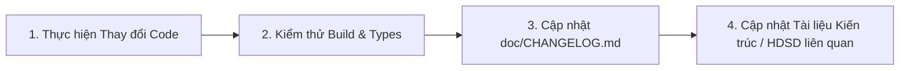

# QUY TẮC PHÁT TRIỂN DỰ ÁN (DEVELOPMENT RULES)

> **QUY TẮC BẮT BUỘC (MANDATORY POLICY)**:
> Mọi thay đổi trong dự án (bao gồm: **THÊM MỚI**, **CHỈNH SỬA**, **XÓA BỎ** bất kỳ tính năng, tệp tin, API, bảng cơ sở dữ liệu hay cấu hình nào) **BẮT BUỘC PHẢI ĐƯỢC GHI LẠI ĐẦY ĐỦ TRONG THƯ MỤC `doc/`**, cụ thể là trong tệp `doc/CHANGELOG.md` và các tài liệu liên quan.

---

## 📋 1. Quy trình Thực hiện Thay đổi

Mỗi khi lập trình viên hoặc AI Agent thực hiện bất kỳ thao tác nào làm thay đổi mã nguồn, quy trình bắt buộc phải tuân theo 4 bước:



1. **Bước 1**: Thực hiện thay đổi trong mã nguồn (`src/`, `backend/`, cấu hình...).
2. **Bước 2**: Chạy kiểm tra kiểu dữ liệu (`npx tsc --noEmit`) và biên dịch (`npm run build`) để đảm bảo không phát sinh lỗi.
3. **Bước 3**: Mở [**`doc/CHANGELOG.md`**](file:///c:/Users/MSI/app_gv/doc/CHANGELOG.md) và thêm mục mới theo chuẩn:
   - **Ngày thay đổi**: Định dạng `YYYY-MM-DD`.
   - **Phân loại**:
     * `[ADDED]` - Tính năng mới, tệp mới được thêm.
     * `[CHANGED]` - Chỉnh sửa logic, giao diện, hành vi của tính năng cũ.
     * `[DEPRECATED]` - Tính năng sắp loại bỏ.
     * `[REMOVED]` - Tính năng hoặc tệp đã bị xóa bỏ hoàn toàn (nêu rõ lý do xóa).
     * `[FIXED]` - Sửa lỗi phát sinh.
     * `[SECURITY]` - Vá bảo mật, phân quyền, cấu hình API Key.
4. **Bước 4**: Nếu thay đổi có liên quan đến:
   - Mô hình dữ liệu $\rightarrow$ Cập nhật [**`doc/KIEN_TRUC_VA_MO_HINH_DU_LIEU.md`**](file:///c:/Users/MSI/app_gv/doc/KIEN_TRUC_VA_MO_HINH_DU_LIEU.md).
   - Thao tác người dùng $\rightarrow$ Cập nhật [**`doc/HUONG_DAN_SU_DUNG.md`**](file:///c:/Users/MSI/app_gv/doc/HUONG_DAN_SU_DUNG.md).
   - Tiến độ dự án $\rightarrow$ Cập nhật [**`doc/TIEN_DO_DA_LAM_VA_CHUA_LAM.md`**](file:///c:/Users/MSI/app_gv/doc/TIEN_DO_DA_LAM_VA_CHUA_LAM.md).
   - Hạ tầng Docker / Server $\rightarrow$ Cập nhật [**`doc/DOCKER_BACKEND.md`**](file:///c:/Users/MSI/app_gv/doc/DOCKER_BACKEND.md).

---

## 🚫 2. Những điều Tuyệt đối Cấm (Strict Prohibitions)
1. **Không xóa file âm thầm**: Nghiêm cấm xóa bỏ file mã nguồn, thư viện, hoặc endpoint mà không có giải trình trong `doc/CHANGELOG.md`.
2. **Không thêm tính năng "ẩn"**: Bất kỳ màn hình, nút bấm hay logic tính toán học phí/lịch dạy nào mới đều phải được giải thích rõ mục đích trong tài liệu.
3. **Không phá vỡ cấu trúc dữ liệu cũ**: Mọi thay đổi cấu trúc bảng database phải có script chuyển đổi dữ liệu (migration script) tương thích ngược.

---

## 🏷️ 3. Định dạng Mẫu Ghi chép trong `doc/CHANGELOG.md`

```markdown
## [Phiên bản hoặc Ngày YYYY-MM-DD] - [Tiêu đề thay đổi ngắn gọn]

### ➕ Đã thêm (Added)
- Thêm file `src/...` để xử lý ...
- Bổ sung trường `...` vào bảng database `...`.

### 🔄 Đã sửa (Changed)
- Cập nhật logic tính tiền trong `FeesPage.tsx` để ...

### ❌ Đã xóa (Removed)
- Xóa bỏ file `...` do đã thay thế bằng `...`.

### 🐛 Đã sửa lỗi (Fixed)
- Sửa lỗi trùng giờ khi chuyển từ tuần này sang tuần sau.
```

